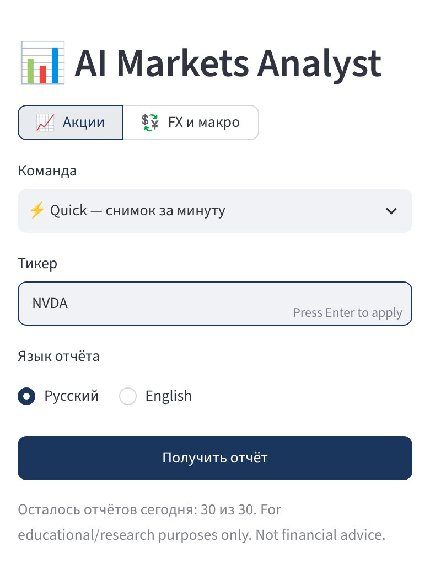
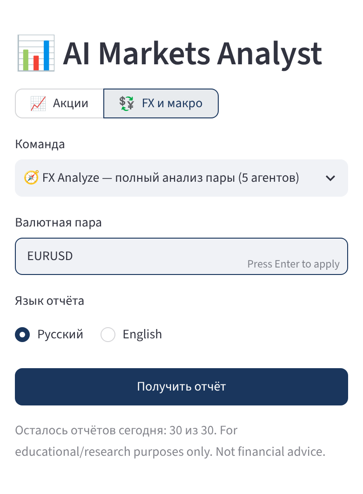
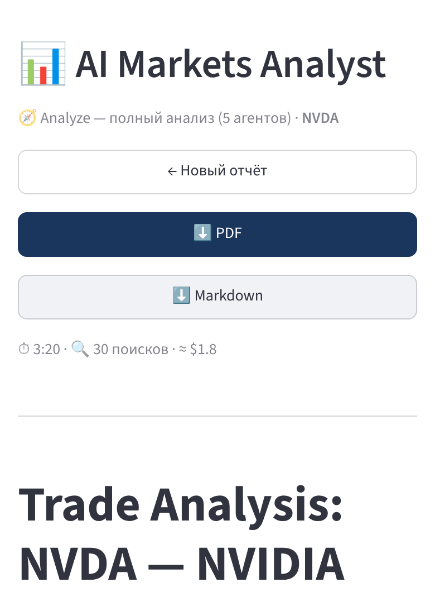
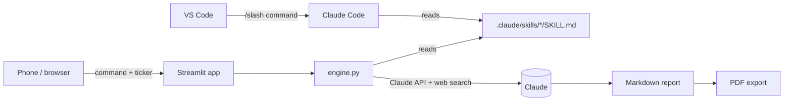

# AI-ME Research Tool

[](LICENSE)


**Equity, FX and macro research on demand — as Claude Code skills and as a mobile web app.**

Pick a command, enter a ticker or currency pair, and get an institutional-style report in 1–6 minutes: scored, sourced, with levels, scenarios and a downloadable PDF. The same `SKILL.md` files power both the Claude Code slash commands in VS Code and the Streamlit web app, so there is one source of truth for the methodology.

<p align="center">
  
  &nbsp;
  
  &nbsp;
  
</p>

---

## What's inside

**24 skills** in two groups:

### Equities — `trade-*`

> Equity skills are from **[ai-trading-claude](https://github.com/zubair-trabzada/ai-trading-claude)** by Zubair Trabzada (MIT), included unchanged. This project adds the FX & macro layer, the parallel web engine and the mobile app.

| Command | What it does |
|---|---|
| `/trade-quick <TICKER>` | 60-second snapshot: signal, key factors, levels |
| `/trade-analyze <TICKER>` | Flagship: discovery → 5 parallel agents (technical, fundamental, sentiment, risk, thesis) → composite **Trade Score** and grade |
| `/trade-fundamental <TICKER>` | Valuation, growth, profitability, balance sheet, moat — Fundamental Score |
| `/trade-technical <TICKER>` | Trend, momentum, volume, patterns, support/resistance — Technical Score |
| `/trade-sentiment <TICKER>` | News, social, analysts, institutions, insiders, short interest |
| `/trade-earnings <TICKER>` | Pre-earnings setup: history, expected move, key metrics |
| `/trade-options <TICKER> [view]` | IV rank, expected move, flow, strategy recommendations |
| `/trade-risk <TICKER>` | Volatility, drawdowns, liquidity, position sizing (Kelly, vol-adjusted) |
| `/trade-thesis <TICKER>` | Bull/bear case, catalysts, entry/exit, asymmetry |
| `/trade-compare <T1> <T2>` | Head-to-head scored comparison |
| `/trade-sector <SECTOR>` | Sector rotation, momentum, money flows |
| `/trade-screen <criteria>` | Growth / value / dividend / momentum / custom screens |
| `/trade-watchlist` | Scored watchlist with alerts |
| `/trade-portfolio` | Allocation, risk, income, rebalancing |
| `/trade-report-pdf` | Compiles all `TRADE-*.md` into a branded PDF |

### FX & Macro — `fx-*`, `macro-*`

| Command | What it does |
|---|---|
| `/fx-quick <PAIR…>` | One-card snapshot per pair: rates, carry, trend, levels, positioning, next catalyst |
| `/fx-analyze <PAIR>` | Flagship: discovery → 5 parallel agents (rates & CBs, macro & valuation, technicals, positioning & flows, vol & event risk) → directional **FX Bias Score**, conviction, trade plan |
| `/fx-carry <PAIR \| G10 \| EM>` | CIP forwards, implied yields, carry-to-vol, breakevens, ranked carry ideas |
| `/fx-vol <PAIR> [view]` | ATM vs realized vol, skew, expected ranges, option structures |
| `/macro-cb <BANK…>` | Central bank stance, market pricing vs projections, next-meeting probabilities |
| `/macro-country <COUNTRY…>` | Macro dashboard, cycle phase, Macro Momentum Score |
| `/macro-calendar [window]` | Event calendar in GST/UTC with scenario maps for top events |
| `/macro-regime` | Cross-asset regime probabilities and the currency map for that regime |
| `/fx-scan [G10 \| EM \| ALL]` | Cross-sectional FX scoreboard: carry, momentum, valuation, repricing |

FX skills handle pegs (AED, SAR, HKD), managed/fixing regimes (CNH, SGD) and NDF markets explicitly instead of forcing a directional call.

---

## How it works



- **Single-pass skills** run as one Claude call with the skill as the system prompt.
- **Orchestrator skills** (`trade-analyze`, `fx-analyze`, or any skill with `PHASE 1/2/3` and `#### Agent N` blocks) run as a pipeline: a discovery brief, then N specialist agents in parallel, then a synthesis step that computes the composite score.
- A runtime adapter tells the model it is in a web context (no files, no subagent tool, web search only) and enforces "never invent numbers — write *Data not available*".
- Each report gets its own URL (`?job=…`), survives the phone screen locking, and identical requests within 6 hours are served from cache.

## Scoring

| System | Scale | Composite |
|---|---|---|
| Trade Score (equities) | 0–100, higher = better | Technical 25% · Fundamental 25% · Sentiment 20% · Risk 15% · Thesis 15% → grade A+ … F |
| FX Bias Score | 0–100, **directional**: 50 neutral, >50 favors base currency | Rates 30% · Technical 25% · Positioning 25% · Macro 20%; the Risk Environment score drives conviction and sizing |

---

## Quick start

You need [Claude Code](https://docs.claude.com/en/docs/claude-code/overview) (CLI or the VS Code extension) and a Claude subscription or API key. No other setup — the skills use Claude's built-in web search.

### Option A — use inside this project (2 minutes)

```bash
git clone https://github.com/xttron2033/AI-ME-Research-Tool.git
cd AI-ME-Research-Tool
claude            # or open the folder in VS Code with the Claude Code extension
```

Then type, for example:

```
/fx-quick EURUSD USDJPY
/fx-analyze EURUSD
/macro-cb FED ECB
/trade-quick NVDA
/trade-analyze NVDA
```

No git? Click **Code → Download ZIP** on this page and unzip it.

### Option B — install the skills globally (available in every project)

```bash
# macOS / Linux
mkdir -p ~/.claude/skills && cp -r .claude/skills/* ~/.claude/skills/
```
```powershell
# Windows (PowerShell)
New-Item -ItemType Directory -Force "$env:USERPROFILE\.claude\skills" | Out-Null
Copy-Item -Recurse -Force .claude\skills\* "$env:USERPROFILE\.claude\skills\"
```

Restart Claude Code and type `/` to see the commands.

### Option C — run the mobile web app with your own API key

```bash
pip install -r requirements.txt
cp .streamlit/secrets.toml.example .streamlit/secrets.toml   # add your Anthropic API key
streamlit run app.py
```

To host it for free on Streamlit Community Cloud, see **[DEPLOY.md](DEPLOY.md)** (in Russian). You pay for your own API usage; the app shows an estimated cost under every report.

---

## Repository layout

```
.claude/
  skills/            24 SKILL.md files — the methodology
  settings.json      Claude Code tool permissions
.streamlit/
  config.toml        theme
  secrets.toml.example
app.py               Streamlit UI: forms, job queue, report view, limits
engine.py            skill runner: single-pass + parallel orchestrator, web-search adapter
pdf_export.py        Markdown → branded PDF (WeasyPrint)
requirements.txt     Python dependencies
packages.txt         system packages for Streamlit Cloud (Pango, DejaVu fonts)
DEPLOY.md            deployment guide (RU)
LICENSE, NOTICE      Apache 2.0 (original parts)
THIRD_PARTY_NOTICES.md, licenses/   MIT notice for trade-* skills
```

## Configuration (`.streamlit/secrets.toml`)

| Key | Default | Purpose |
|---|---|---|
| `ANTHROPIC_API_KEY` | — | required |
| `APP_PASSWORD` | empty | optional access code for the web app |
| `DAILY_LIMIT` | `30` | max reports per day across all users |
| `MODEL` | `claude-sonnet-5-5` | e.g. `claude-haiku-5-5` for cheaper, faster runs |
| `MAX_PARALLEL` | `3` | parallel agents in orchestrator skills; lower it if you hit rate limits |

## Data & limitations

- Market data comes from live web search at run time. Every figure should carry a source and as-of date; missing data is labeled, not estimated.
- Interbank FX vol surfaces, risk reversals and some positioning data are not public, so `fx-vol` relies on reported figures and CME CVOL where available.
- Indicative cost per report on Sonnet: quick ≈ $0.1–0.3, single skill ≈ $0.3–0.8, full analyze ≈ $1–3. The app shows an estimate under each report.

---

> **Disclaimer.** For educational and research purposes only. Nothing in this repository or its output is investment advice or a recommendation to buy or sell any security, currency or derivative. AI-generated analysis can be wrong or out of date — verify independently.

## Contributing

Issues and pull requests are welcome — especially new skills, better data sources, and fixes to scoring logic. A skill is just a folder with a `SKILL.md`; follow the structure of an existing one. Orchestrator skills need `### PHASE 1/2/3` sections and `#### Agent N:` blocks so the web engine can run them in parallel.

## Credits & license

- `trade-*` equity skills — [ai-trading-claude](https://github.com/zubair-trabzada/ai-trading-claude) © 2026 Zubair Trabzada, MIT License ([text](licenses/ai-trading-claude-MIT.txt)).
- Everything else — `fx-*` and `macro-*` skills, `app.py`, `engine.py`, `pdf_export.py`, docs — © 2026 Egor Zhilnikov, [Apache License 2.0](LICENSE).

See [THIRD_PARTY_NOTICES.md](THIRD_PARTY_NOTICES.md) and [NOTICE](NOTICE). When redistributing, keep both license texts and the NOTICE file.
